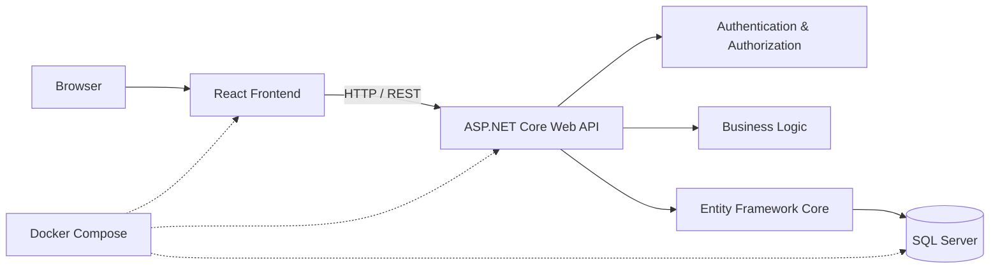

# 🎓 University Management System

A full-stack university management platform built with **ASP.NET Core 8 Web API**, **React 19**, **SQL Server**, and **Docker**.

The system provides role-based workflows for **Administrators, Instructors, and Students**, covering student and instructor management, courses, course offerings, enrollments, academic marks, authentication, and role-specific dashboards.

This project was built to demonstrate practical full-stack development using a modern **.NET + React** architecture with REST APIs, secure authentication, relational database design, validation, and containerization.

---

## Accouts to Test

> Add screenshots of the running application here.

| Admin Account            | Instructor Account      |
| ------------------------ | ----------------------- |
| Email: `admin@gmail.com` | Email:`inst@gmail.com ` |
| Password: `Admin123456`  | Password:`Teach123456`  |

| Student Account  
| ----------------------------------------
| Email: `std@gmail.com` |
| Password: `Std123456` |

---

## ✨ Key Features

### 🔐 Authentication & Authorization

- Email and password authentication
- JWT access tokens
- Refresh-token mechanism
- Secure password hashing using BCrypt
- Role-based authorization
- Protected frontend routes
- Role-aware navigation
- Authentication rate limiting
- Logout and refresh-token handling

### 👨‍💼 Administrator

Administrators can manage the main academic data of the system:

- Manage students
- Manage instructors
- Manage courses
- Create and manage course offerings
- Assign instructors to course offerings
- Manage enrollment-related workflows
- View administrative dashboard information

### 👨‍🏫 Instructor

Instructor functionality includes:

- View assigned course offerings
- Access students enrolled in relevant offerings
- Add student marks
- Update existing marks
- View offering-related academic information
- Access an instructor-specific dashboard

### 🎓 Student

Students can:

- Browse available course offerings
- Access enrollment-related information
- View their academic marks
- Access a personalized student dashboard

### 📚 Course & Enrollment Management

- Course creation and management
- Course offering management
- Instructor assignment
- Offering capacity management
- Offering status handling
- Student enrollment
- Duplicate enrollment prevention
- Capacity validation before enrollment
- Enrollment queries by student and course offering

### 📝 Academic Marks

- Record marks for enrolled students
- Update existing marks
- Retrieve marks for individual students
- Retrieve marks for students within a course offering
- Support multiple exam types
- Enforce exam progression rules

The current academic rules include:

- A **Second Exam** mark requires an existing **First Exam** mark.
- A **Final Exam** mark requires both **First** and **Second Exam** marks.

---

## 🛠️ Tech Stack

### Backend

- **ASP.NET Core 8 Web API**
- **C#**
- **Entity Framework Core**
- **LINQ**
- **JWT Bearer Authentication**
- **BCrypt**
- **FluentValidation**
- **Swagger / OpenAPI**
- **Dependency Injection**
- **Async/Await**

### Frontend

- **React 19**
- **JavaScript / JSX**
- **Vite**
- **React Router**
- **Axios**
- **Tailwind CSS**
- **Radix UI**
- **Lucide React**
- **Sonner**

### Database

- **Microsoft SQL Server 2022**
- **Entity Framework Core Migrations**
- Relational database design
- Unique constraints
- Check constraints
- Transactional operations

### DevOps & Tools

- **Docker**
- **Docker Compose**
- **Git**
- **GitHub**
- **Swagger**
- **Postman**

---

## 🏗️ Architecture

The application follows a separated frontend/backend architecture.



### Request Flow

```text
User
  │
  ▼
React Frontend
  │
  │ HTTP Request
  ▼
ASP.NET Core Web API
  │
  ├── Authentication / Authorization
  ├── Validation
  ├── Business Rules
  │
  ▼
Entity Framework Core
  │
  ▼
SQL Server
```

The frontend communicates with the backend through REST API endpoints using Axios.

The backend handles authentication, authorization, validation, business rules, and database operations through Entity Framework Core.

---

## 👥 Roles

The system uses role-based access control to separate functionality between different types of users.

| Role           | Main Responsibilities                                                                      |
| -------------- | ------------------------------------------------------------------------------------------ |
| **Admin**      | Manage students, instructors, courses, course offerings, and administrative data           |
| **Instructor** | Access assigned offerings, enrolled students, and academic mark workflows                  |
| **Student**    | Access course offering information, enrollment data, personal marks, and student dashboard |

Authorization is enforced at the API level, while the React application also uses protected and role-aware routes.

---

## 🗄️ Database Design

The system uses a relational SQL Server database managed through Entity Framework Core.

### Main Entities

```text
User
├── Student
├── Instructor
└── Admin

Course
   │
   ▼
Course Offering
   │
   ├── Instructor
   │
   ▼
Enrollment
   │
   ├── Student
   │
   ▼
Student Mark
   │
   └── Exam Type
```

Main entities include:

- `clsUser`
- `clsStudent`
- `clsInstructor`
- `clsAdmin`
- `clsCourse`
- `clsCourseOffering`
- `clsEnrollments`
- `clsExamType`
- `clsStudentMark`

### Data Integrity

The database and application include rules such as:

- Unique user emails
- Unique course names
- Duplicate enrollment prevention
- Offering capacity validation
- Unique enrollment/exam-type mark combinations
- Mark-related validation
- Course offering constraints

EF Core migrations are included in the project for managing database schema changes.

---

## 🔐 Authentication Flow

Authentication is based on **JWT access tokens and refresh tokens**.

```text
User Login
    │
    ▼
Email + Password
    │
    ▼
ASP.NET Core API
    │
    ├── Validate Credentials
    │
    ├── Generate Access Token
    │
    └── Generate Refresh Token
    │
    ▼
React Application
    │
    ├── Authenticated Requests
    │
    ▼
Protected API Endpoints
```

When an access token expires, the refresh-token mechanism can be used to obtain a new authentication token without requiring the user to log in again.

Backend endpoints use role-based authorization to restrict access to appropriate users.

---

## 🌐 API

The backend exposes REST API endpoints for authentication and academic management.

Swagger/OpenAPI is available during development for exploring and testing the API.

### Example Endpoints

#### Authentication

```http
POST /api/Auth/Login
POST /api/Auth/Refresh
POST /api/Auth/logout
```

#### Courses

```http
GET  /api/Course/GetAllCourses
GET  /api/Course/GetById/{id}
GET  /api/Course/GetByName?name={name}
POST /api/Course/AddCourse
```

#### Course Offerings

```http
GET  /api/CourseOffering/GetAllCourseOfferings
POST /api/CourseOffering/AddNewOffer
```

Pagination is supported when retrieving course offerings.

Example:

```http
GET /api/CourseOffering/GetAllCourseOfferings?pageNumber=1&pageSize=10
```

#### Enrollments

```http
GET  /api/Enrollment/GetEnrollmentsByStudentID/{studentId}
POST /api/Enrollment/AddNewEnrollment
```

#### Student Marks

```http
GET  /api/StudentMarks/MyMarks
POST /api/StudentMarks/AddNewMark
PUT   /api/StudentMarks/UpdateMark
```

#### Dashboards

```http
GET /api/Dashboard/Admin
GET /api/Dashboard/instructorDashboard
GET /api/Dashboard/studentDashboard
```

> Swagger contains the complete API definitions, request models, and response schemas.

---

## 📁 Project Structure

```text
University-Management-System/
│
├── docker-compose.yml
├── Lpgin2.postman_collection.json
│
├── Univercity Management System/
│   │
│   ├── Controllers/
│   ├── Data/
│   ├── DTOs/
│   ├── Extentions/
│   ├── Helpers/
│   ├── Middlewares/
│   ├── Migrations/
│   │
│   ├── Models/
│   │   ├── Entities/
│   │   └── MTM/
│   │
│   ├── Services/
│   ├── Validators/
│   │
│   ├── Program.cs
│   ├── Dockerfile
│   └── Lpgin2.csproj
│
└── UMSui/
    │
    ├── public/
    │
    ├── src/
    │   ├── API/
    │   ├── Context/
    │   ├── Hooks/
    │   ├── Layoutes/
    │   ├── Pages/
    │   ├── Routes/
    │   └── Services/
    │
    ├── Dockerfile
    ├── package.json
    └── vite.config.js
```

---

## 🐳 Running with Docker

The application includes Docker support for the:

- React frontend
- ASP.NET Core backend
- SQL Server database

### Prerequisites

Make sure you have installed:

- Docker
- Docker Compose

### Start the Application

From the project root:

```bash
docker compose up --build
```

Docker Compose will build and start the application services.

### Local Ports

| Service     | Address                         |
| ----------- | ------------------------------- |
| Frontend    | `http://localhost:8081`         |
| Backend API | `http://localhost:8080`         |
| Swagger     | `http://localhost:8080/swagger` |
| SQL Server  | `localhost,14330`               |

### Stop the Application

```bash
docker compose down
```

SQL Server data is stored in the configured Docker volume:

```text
ums_sqlserver-data
```

This allows database data to persist when containers are stopped and recreated.

---

## 💻 Running Locally

You can also run the frontend and backend separately during development.

### Backend

Requirements:

- .NET 8 SDK
- SQL Server

Restore dependencies:

```bash
dotnet restore "Univercity Management System/Lpgin2.csproj"
```

Build the project:

```bash
dotnet build "Univercity Management System/Lpgin2.csproj"
```

Run the API:

```bash
dotnet run --project "Univercity Management System/Lpgin2.csproj"
```

Make sure the database connection string is correctly configured before starting the API.

### Frontend

Requirements:

- Node.js
- npm

Navigate to the frontend:

```bash
cd UMSui
```

Install dependencies:

```bash
npm install
```

Start the Vite development server:

```bash
npm run dev
```

Configure the frontend API URL using the expected `VITE_API_URL` environment variable.

Example:

```env
VITE_API_URL=http://localhost:8080
```

---

## 🧪 Validation & Business Rules

The project includes validation at multiple levels.

### Application Validation

- Request validation
- Required-field validation
- Email validation
- Course and offering validation
- Enrollment validation
- Academic mark validation

### Business Rules

Examples of implemented business rules include:

- A student cannot enroll in the same course offering more than once.
- Enrollment is restricted according to course offering availability.
- Course offering capacity is enforced.
- Academic marks are associated with valid enrollments.
- Duplicate marks for the same enrollment and exam type are prevented.
- Exam progression requirements are enforced.

### Database Integrity

SQL Server constraints complement application-level validation to protect data consistency.

---

## ⚡ Backend Practices Demonstrated

The backend demonstrates several common ASP.NET Core development practices:

- RESTful API development
- DTO-based API communication
- Dependency Injection
- Entity Framework Core
- LINQ queries
- Async database operations
- JWT authentication
- Role-based authorization
- Refresh tokens
- Password hashing
- FluentValidation
- Database transactions
- Pagination
- Swagger/OpenAPI documentation
- Database migrations

---

## ⚛️ Frontend Practices Demonstrated

The React frontend demonstrates:

- Component-based UI development
- React Hooks
- Custom data-fetching hooks
- Authentication Context
- Protected routes
- Role-based routing
- Axios API communication
- Loading and error states
- User feedback notifications
- Reusable UI components
- Responsive layouts

---

## 🔒 Configuration & Security

Sensitive configuration should be supplied through environment-specific configuration or environment variables.

Do **not** commit real:

- Database passwords
- JWT signing keys
- Production connection strings
- Other application secrets

For a public or production deployment, configure appropriate CORS origins and secure production credentials.

---

## 🚀 Future Improvements

Planned improvements include:

- Unit tests
- Integration tests
- CI/CD pipeline
- Improved Docker health checks
- Automated database initialization
- Improved production configuration
- Additional reporting features
- Deployment of a live demo

---

## 📸 Screenshots

Screenshots from the running application can be added under:

```text
docs/screenshots/
```

Recommended screenshots:

```text
docs/screenshots/
├── login.png
├── admin-dashboard.png
├── instructor-dashboard.png
├── student-dashboard.png
├── students.png
├── courses.png
├── course-offerings.png
└── student-marks.png
```

Then display them in this README:

```md
## Admin Dashboard


## Course Offerings


```

---

## 👨‍💻 Author

**Dilar Al Maao**

Full Stack Developer focused on **ASP.NET Core, React, and SQL Server**.

- GitHub: https://github.com/ENGDILAR
- LinkedIn: https://www.linkedin.com/in/dilar-al-maao-a98279290
- Portfolio: https://dilarportoflio.netlify.app/
- Email: dilaralmio@gmail.com

---

## 📄 Project Purpose

This project was developed as a full-stack portfolio project to demonstrate practical experience building a complete web application with:

**ASP.NET Core + React + SQL Server + Docker**

It demonstrates the integration of frontend development, REST API development, authentication, authorization, database design, business rules, and containerization within a single application.
